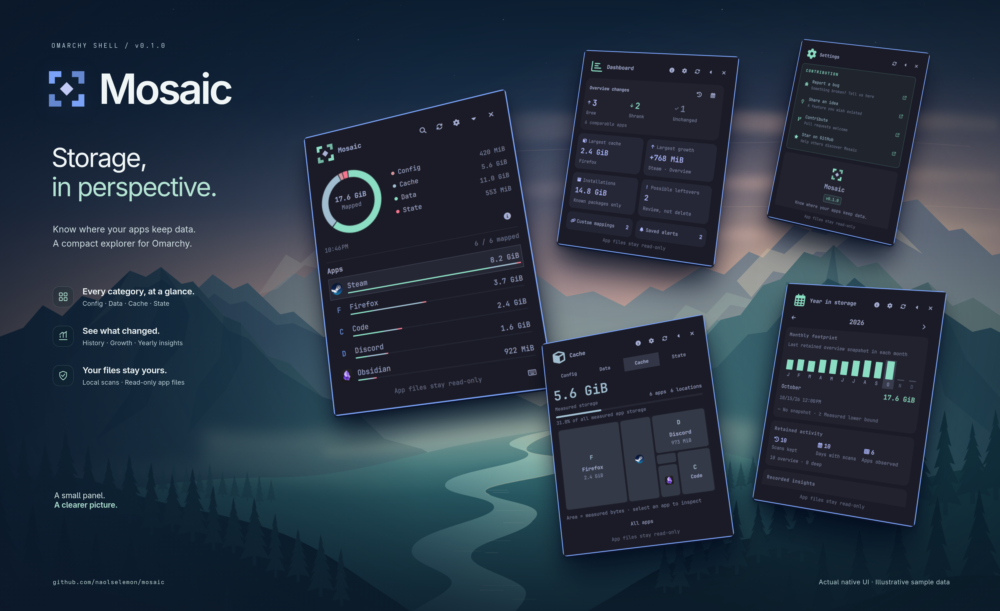
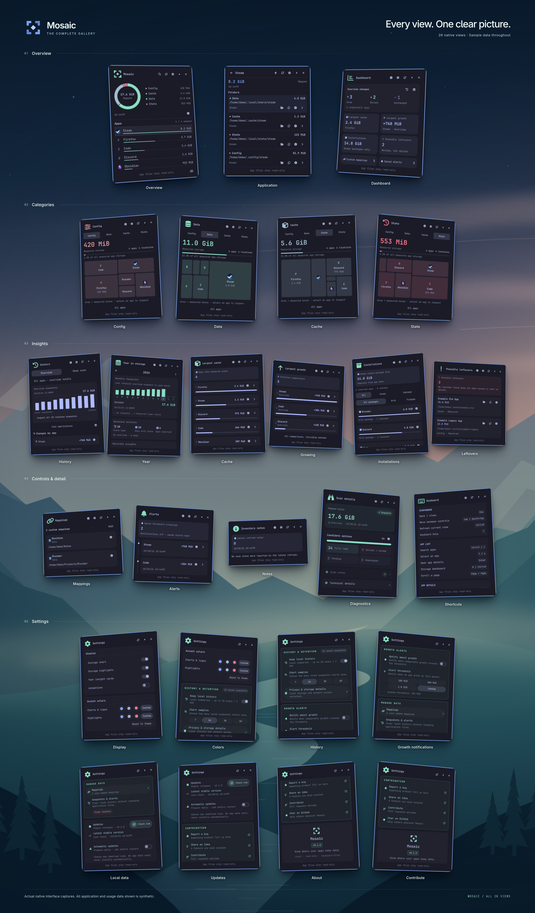

<p align="center">
  
</p>

<h1> Mosaic</h1>

A compact, read-only **application-storage explorer for Omarchy**.

- **Explore** config, data, cache and state through interactive charts and app-level details.
- **Understand** history, growth, installation sizes and possible leftovers.
- **Stay in control**: app files stay untouched, history is opt-in, and updates require restart approval.

An app-storage map—not a full-disk report or a cleanup tool.

<details>
<summary><b>Explore every page</b></summary>
<br>
<a href="preview-pages.png"></a>
</details>

<a id="installation-and-development"></a>

## Install

```sh
omarchy plugin add https://github.com/naolselemon/mosaic.git --enable
```

Requires plugin-capable Omarchy and Python 3. [Full requirements](docs/guide.md#installation).

Click the bar icon to explore. Click the Mosaic logo for the dashboard; press **?** for shortcuts.

[User guide](docs/guide.md) · [Releases](https://github.com/naolselemon/mosaic/releases) · [Older development copies](docs/guide.md#older-development-copies)

## Make it better

[Report a bug](https://github.com/naolselemon/mosaic/issues) · [Contribute](CONTRIBUTING.md) · [Report a vulnerability privately](SECURITY.md)

[MIT licensed](LICENSE) · Built by [Naol Selemon](https://github.com/naolselemon)

UI inspiration: [Screen Time](https://github.com/ax1g/quickshell-screentime-plugin) by [ax1g](https://github.com/ax1g).
